<div align="center">

🇬🇧 **English** | 🇹🇷 [Türkçe](README.tr.md)


# Flick Sage

**A movie discovery platform with family profiles, personal watchlists and AI-powered recommendations.**

[](https://skillicons.dev)


</div>

> **Language note:** The user interface is in English. Some server-side validation and error messages (e.g. login/registration errors, password rules) are in Turkish.

## 🎬 Demo

<div align="center">
  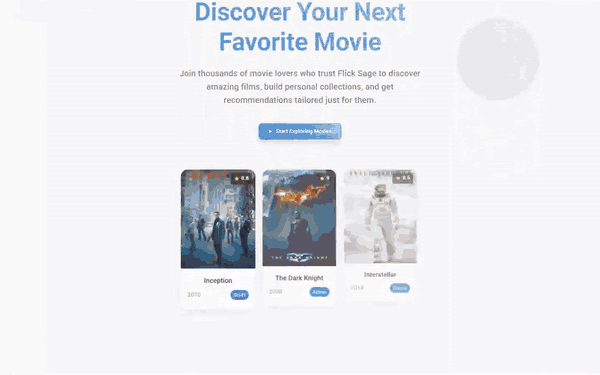
</div>

▶️ Full-quality video: [docs/demo.mp4](docs/demo.mp4)

## 📸 Screenshots

| Landing | Sign in | Profile selection |
|:---:|:---:|:---:|
| 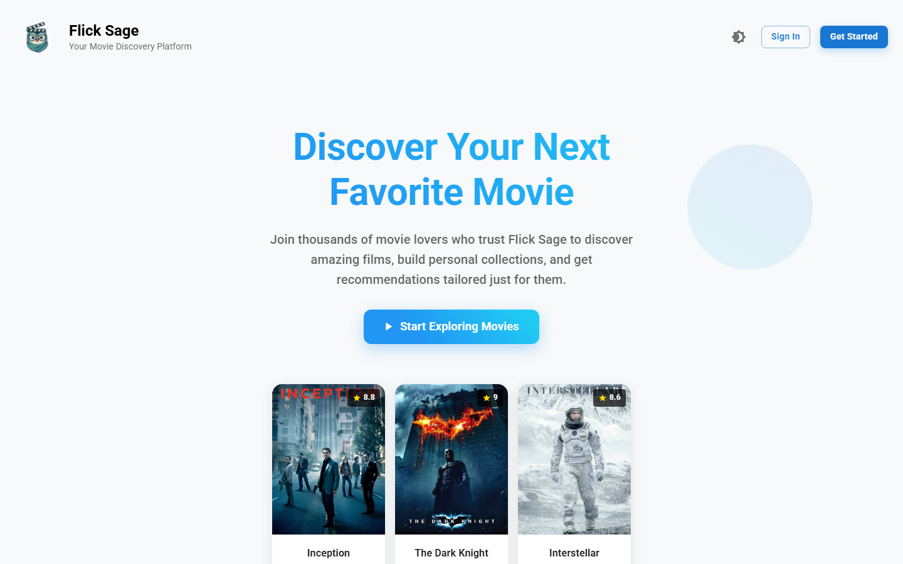 | 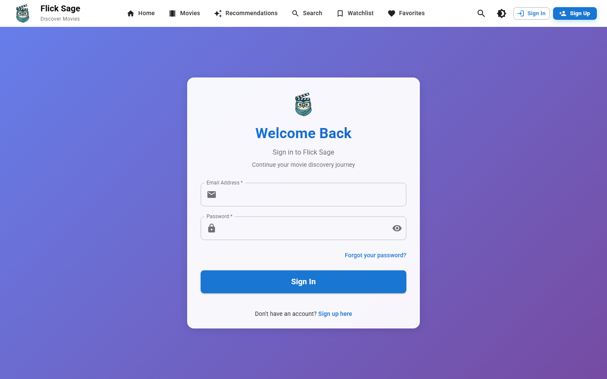 | 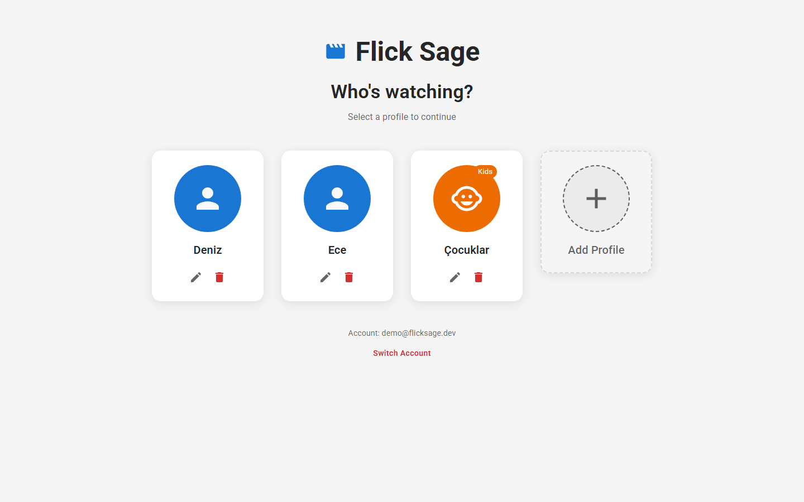 |
| **Home** | **Movie details** | **Search** |
| 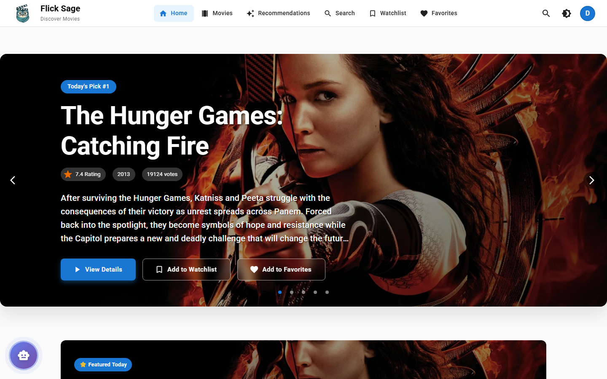 | 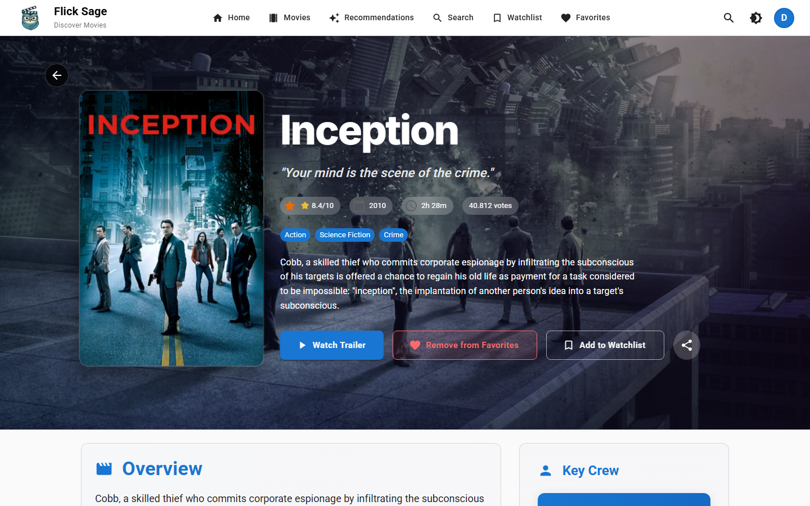 | 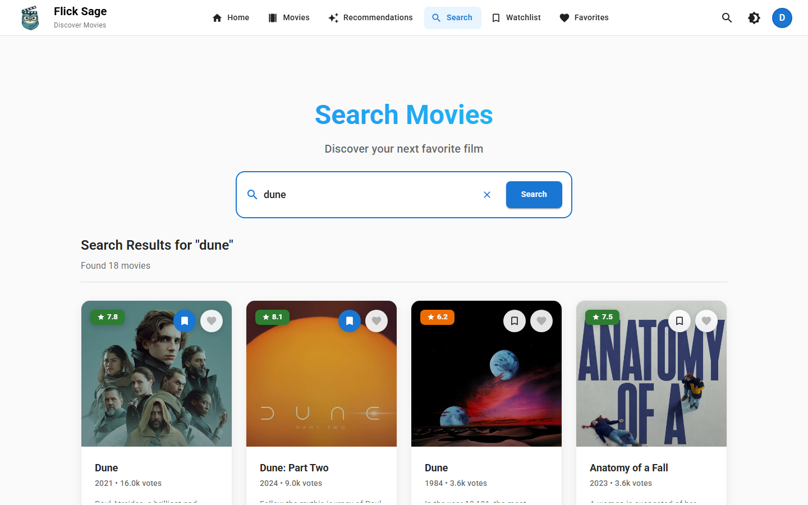 |
| **Recommendations** | **Trending analysis** | **All genres** |
| 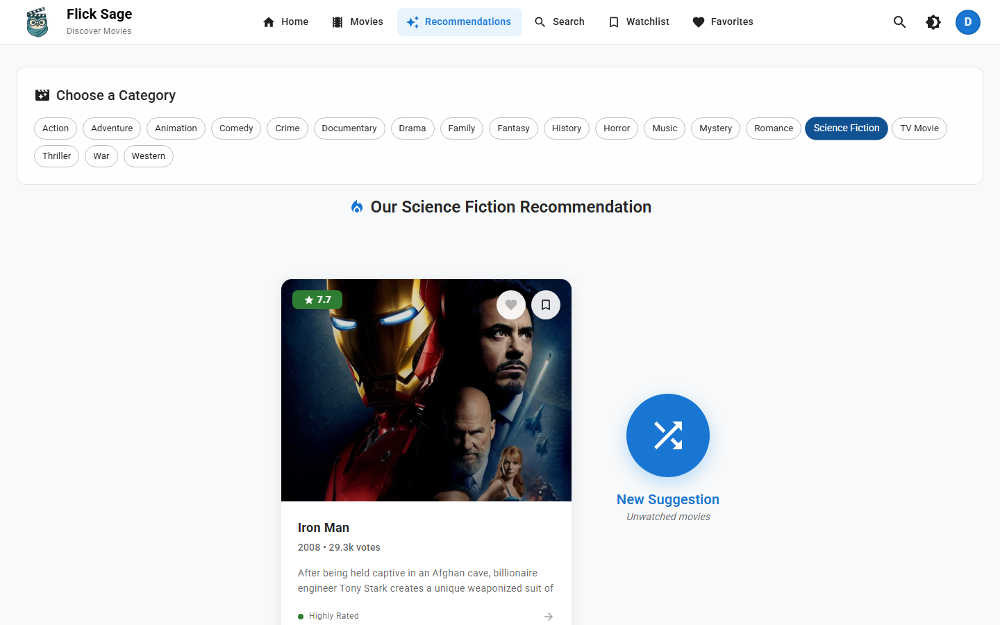 | 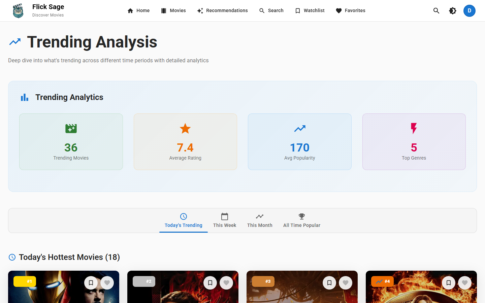 | 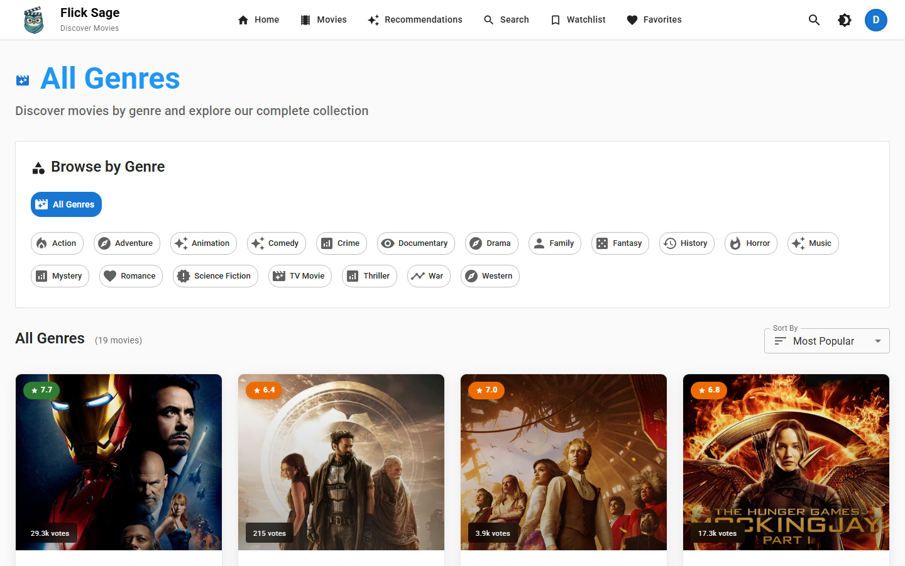 |
| **Favorites** | **Watchlist** | **Profile** |
| 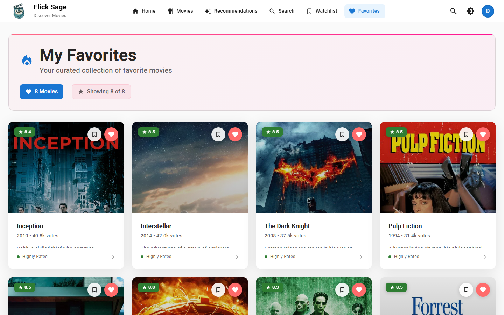 | 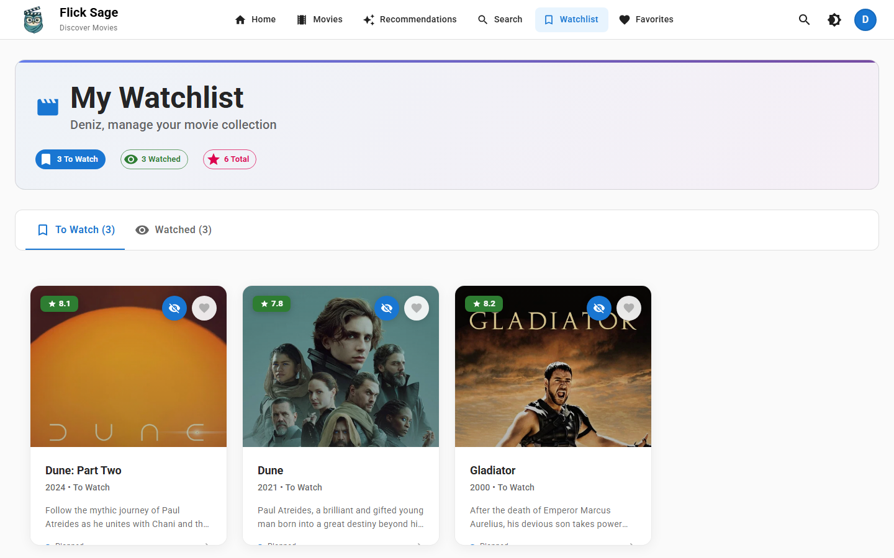 | 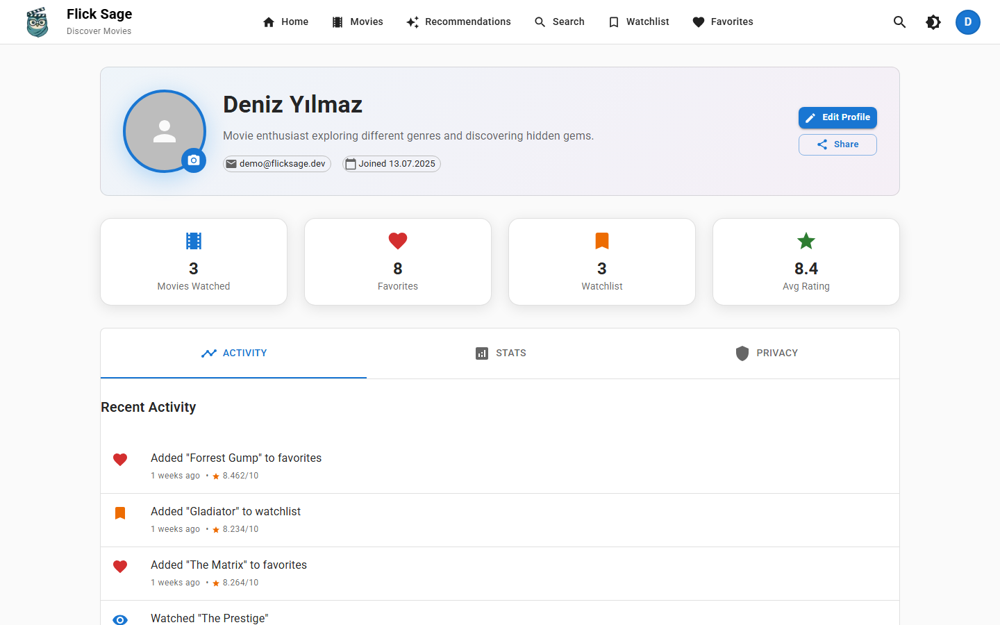 |
| **Dark mode** | | |
| 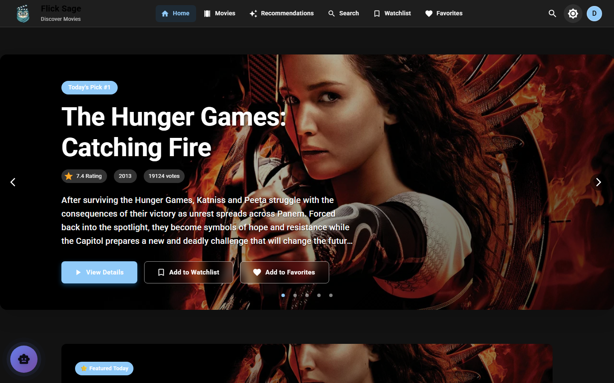 | | |

## ✨ Features

| Feature | Description |
|---|---|
| 🔐 Authentication | Register / sign in with email and password. Passwords are hashed with bcrypt; sessions use a JWT (7 days) stored in localStorage and an HTTP-only cookie. |
| 👨‍👩‍👧 Family profiles | Up to 5 profiles per account ("Who's watching?"), each with its own favorites and watchlist. Profiles can be created, edited, deleted and marked as kids profiles (shown with a badge). |
| 🏠 Home feed | Hero carousel ("Today's Pick"), trending, popular, top-rated and upcoming movies, genre shortcuts and decade-based picks from TMDB. |
| 🤖 AI recommendations | A chat-style assistant on the home page sends your request plus your favorite movies to Google Gemini and returns 3 suggestions, which are then matched to TMDB. |
| 🎯 Category recommendations | Pick a genre and get a random suggestion, then roll a "New Suggestion" for something else you haven't watched. |
| 🔎 Search | Movie search through a server-side API route, with popular search shortcuts and a quick search in the header. |
| 📈 Trending analysis | Today / this week / this month / all-time tabs with summary stats (count, average rating, popularity, top genres). |
| 🗂️ All genres | Browse movies by genre with sorting and "load more" pagination. |
| 🎞️ Movie details | Backdrop, poster, tagline, runtime, genres, overview, cast & crew, YouTube trailer and a share button. |
| ❤️ Favorites | Add / remove favorites per profile. |
| 📌 Watchlist | "To Watch" and "Watched" tabs; mark movies as watched. |
| 👤 Profile page | Stats (watched, favorites, watchlist, average rating), recent activity, achievements, profile picture, password and email change. |
| 💾 Data export / import | Export a profile's watchlist and favorites as JSON and import them back. |
| 🌗 Dark mode | Light / dark theme toggle, saved in localStorage. |
| 🛡️ Content filter | Adult and inappropriate titles are filtered out of TMDB results. |

## 🧰 Tech Stack

| Layer | Technology |
|---|---|
| Framework | Next.js 15 (App Router, Route Handlers) |
| UI | React 19, Material UI 7, Emotion, Tailwind CSS 4 |
| Language | TypeScript 5 |
| Database | PostgreSQL |
| ORM / migrations | Drizzle ORM, drizzle-kit |
| Auth | jsonwebtoken, bcryptjs |
| External APIs | TMDB (movie data and images), Google Gemini (AI suggestions) |

## 🏗️ Architecture

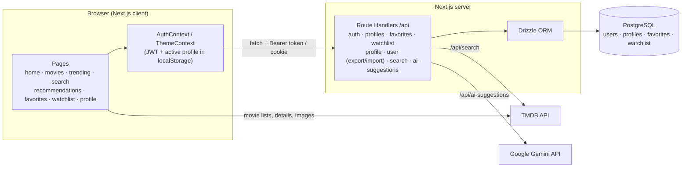

## 📁 Project Structure

```
flicksage/
├── drizzle/                  # drizzle-kit metadata
├── public/                   # logo and static assets
├── docs/                     # demo video, GIF and screenshots
├── src/
│   ├── app/
│   │   ├── api/
│   │   │   ├── auth/         # register, login, logout, change-password, update-email
│   │   │   ├── profiles/     # profile CRUD + select
│   │   │   ├── profile/      # account stats and profile update
│   │   │   ├── favorites/
│   │   │   ├── watchlist/
│   │   │   ├── user/         # export-data, import-data, update-profile-picture
│   │   │   ├── search/
│   │   │   └── ai-suggestions/
│   │   ├── homepage/  movies/  trending/  all-genres/  recommendations/
│   │   ├── search/  movie/[id]/  favorites/  watchlist/
│   │   ├── profile/  profiles/  login/  register/
│   │   ├── layout.tsx
│   │   └── page.tsx          # landing page
│   ├── components/Header.tsx
│   ├── contexts/             # AuthContext, ThemeContext
│   ├── lib/
│   │   ├── auth.ts           # hashing, JWT, validation
│   │   └── db/               # Drizzle client and schema
│   └── utils/avatars.ts
├── drizzle.config.ts
└── package.json
```

## 🚀 Getting Started

### Prerequisites

- Node.js 20+
- A PostgreSQL database
- A [TMDB API key](https://www.themoviedb.org/settings/api)
- A [Google Gemini API key](https://aistudio.google.com/app/apikey) (only needed for AI recommendations)

### Installation

```bash
git clone https://github.com/LordAurora/flicksage.git
cd flicksage
npm install
```

Create a `.env.local` file in the project root:

```env
DATABASE_URL=
JWT_SECRET=
NEXT_PUBLIC_TMDB_API_KEY=
GEMINI_API_KEY=
```

| Variable | Description |
|---|---|
| `DATABASE_URL` | PostgreSQL connection string |
| `JWT_SECRET` | Long random string used to sign tokens (required; requests are rejected without it) |
| `NEXT_PUBLIC_TMDB_API_KEY` | TMDB v3 API key (used in the browser and in `/api/search`) |
| `GEMINI_API_KEY` | Google Gemini API key (server-side only) |

Create the tables and start the app:

```bash
npm run db:push
npm run dev
```

Open [http://localhost:3000](http://localhost:3000).

## 📜 Scripts

| Command | Description |
|---|---|
| `npm run dev` | Start the development server (Turbopack) |
| `npm run build` | Create a production build |
| `npm run start` | Run the production build |
| `npm run db:push` | Push the Drizzle schema to the database |
| `npm run db:generate` | Generate SQL migrations from the schema |
| `npm run db:migrate` | Apply generated migrations |
| `npm run db:studio` | Open Drizzle Studio |

## 🙏 Credits

This product uses the TMDB API but is not endorsed or certified by TMDB. Movie data and images © their respective owners, provided by [The Movie Database](https://www.themoviedb.org/).

The screenshots and demo video were recorded against a local database with a fictional demo account.
