<div align="center">

🇬🇧 [English](README.md) | 🇹🇷 **Türkçe**


# Flick Sage

**Aile profilleri, kişisel izleme listeleri ve yapay zekâ destekli önerilerle film keşif platformu.**

[](https://skillicons.dev)


</div>

> **Dil notu:** Arayüz İngilizcedir. Sunucu tarafındaki bazı doğrulama ve hata mesajları (giriş/kayıt hataları, şifre kuralları gibi) Türkçedir.

## 🎬 Demo

<div align="center">
  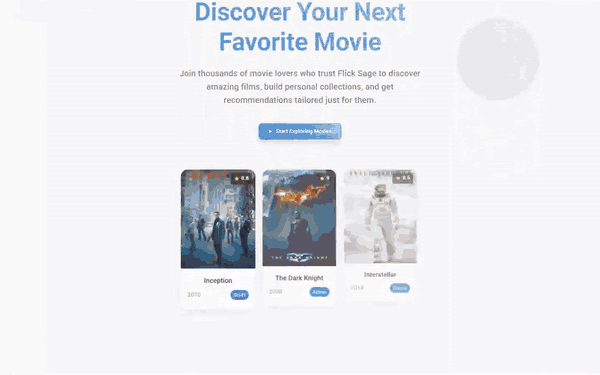
</div>

▶️ Yüksek kaliteli video: [docs/demo.mp4](docs/demo.mp4)

## 📸 Ekran Görüntüleri

| Karşılama | Giriş | Profil seçimi |
|:---:|:---:|:---:|
| 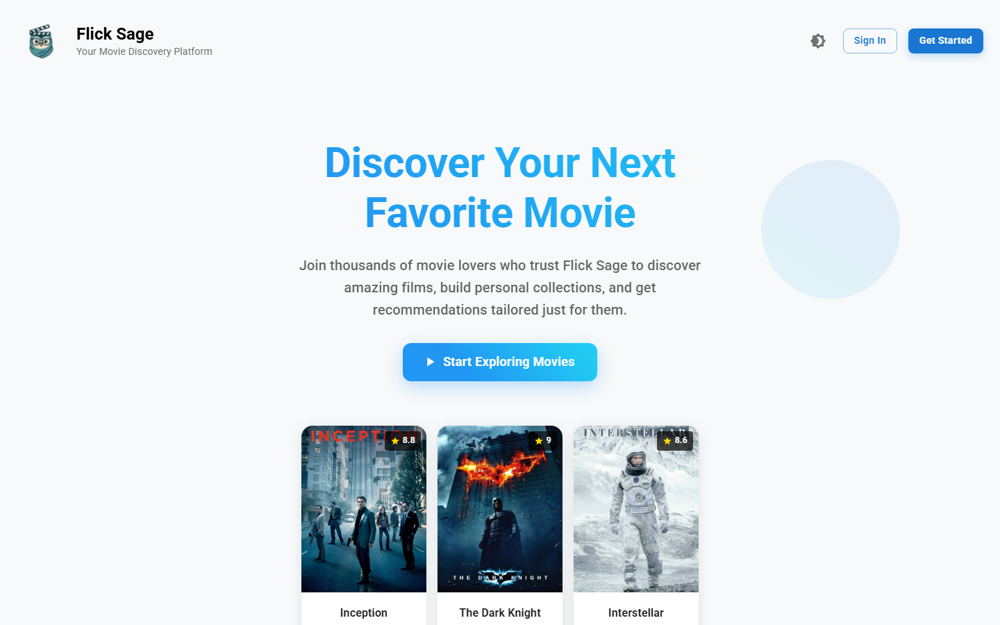 | 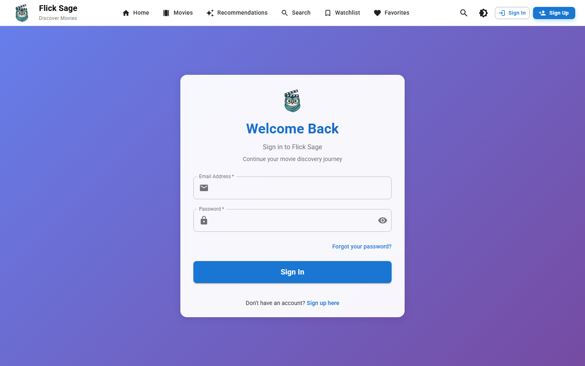 | 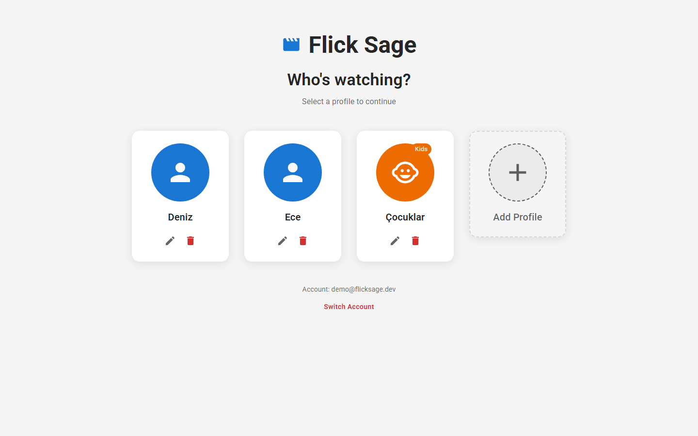 |
| **Ana sayfa** | **Film detayı** | **Arama** |
| 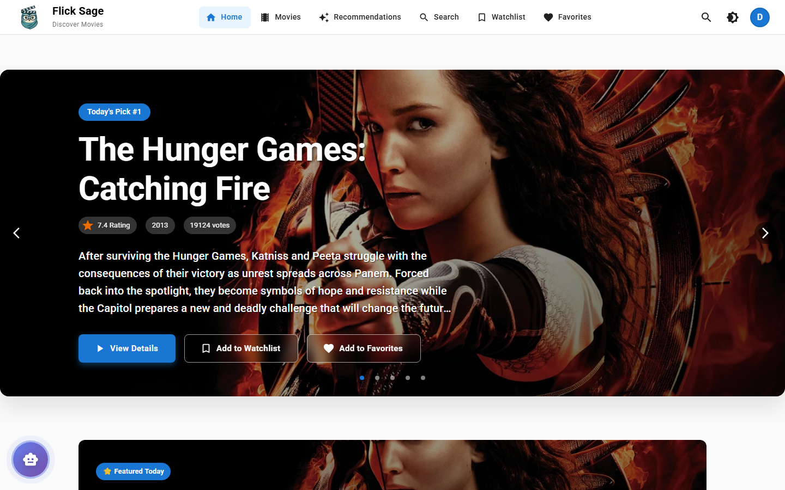 | 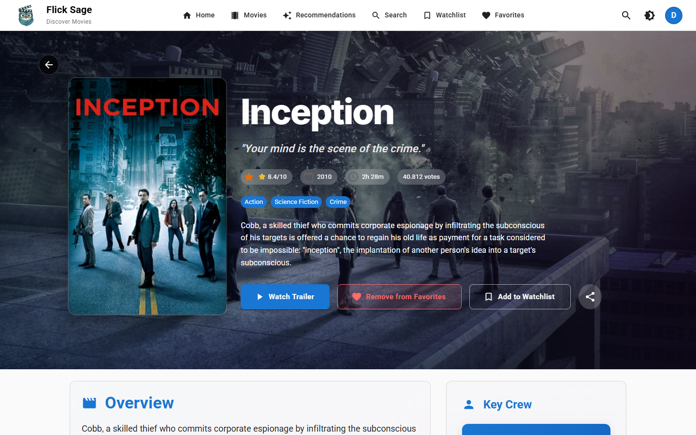 | 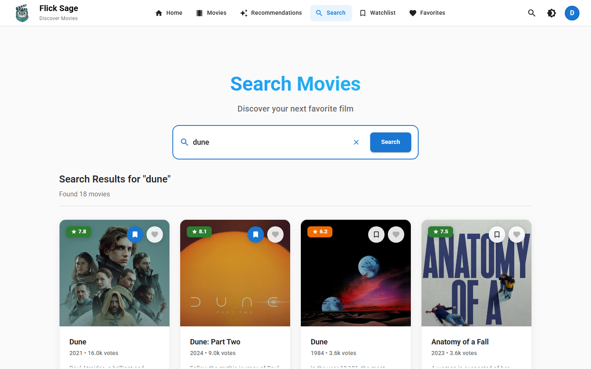 |
| **Öneriler** | **Trend analizi** | **Tüm türler** |
| 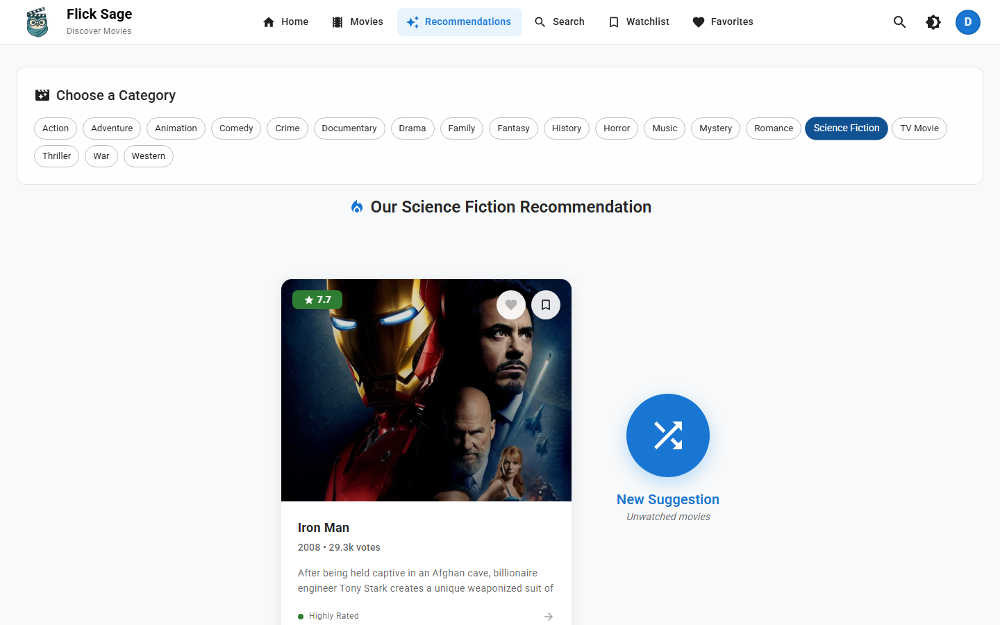 | 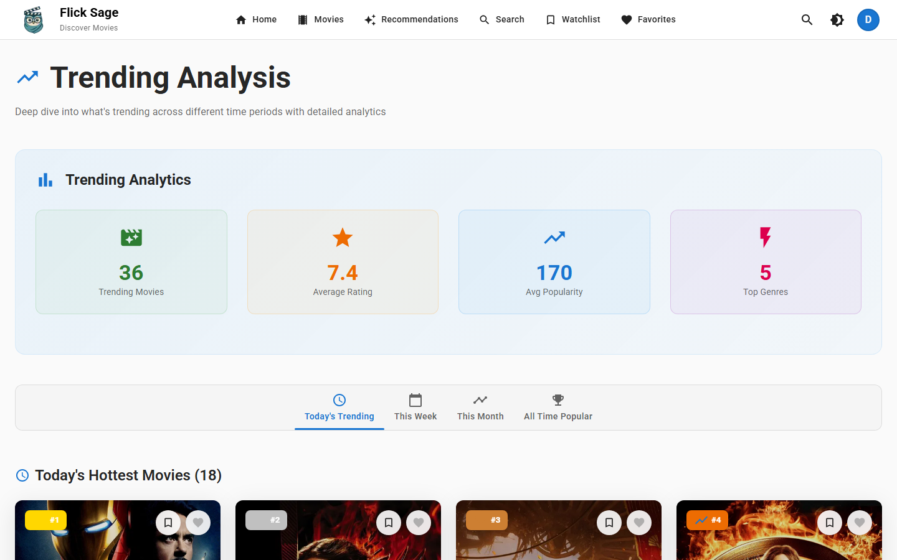 | 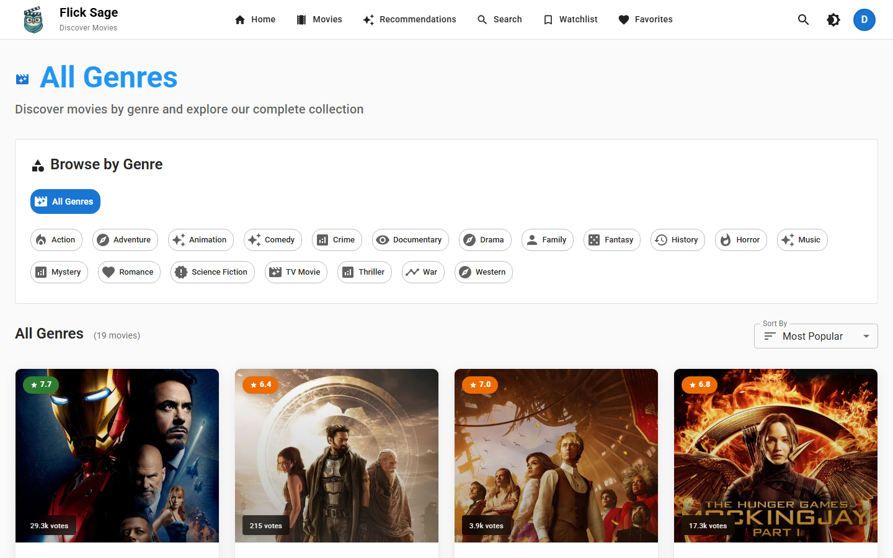 |
| **Favoriler** | **İzleme listesi** | **Profil** |
| 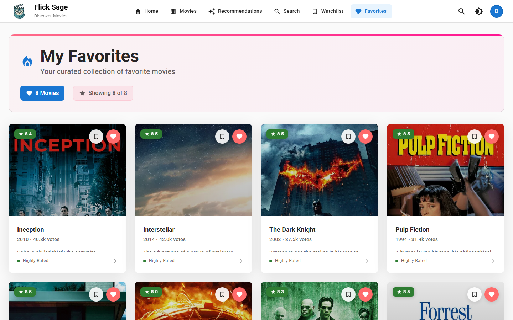 | 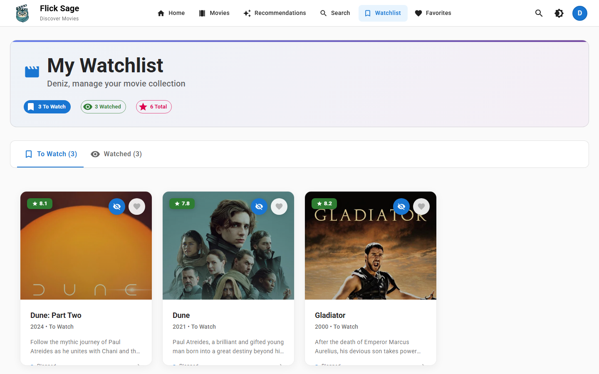 | 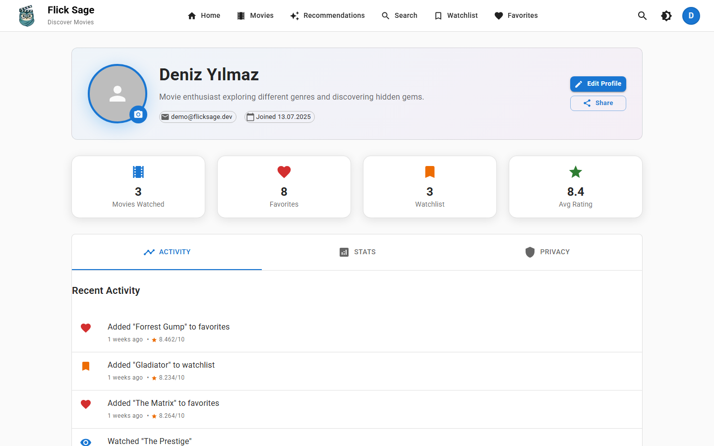 |
| **Karanlık mod** | | |
| 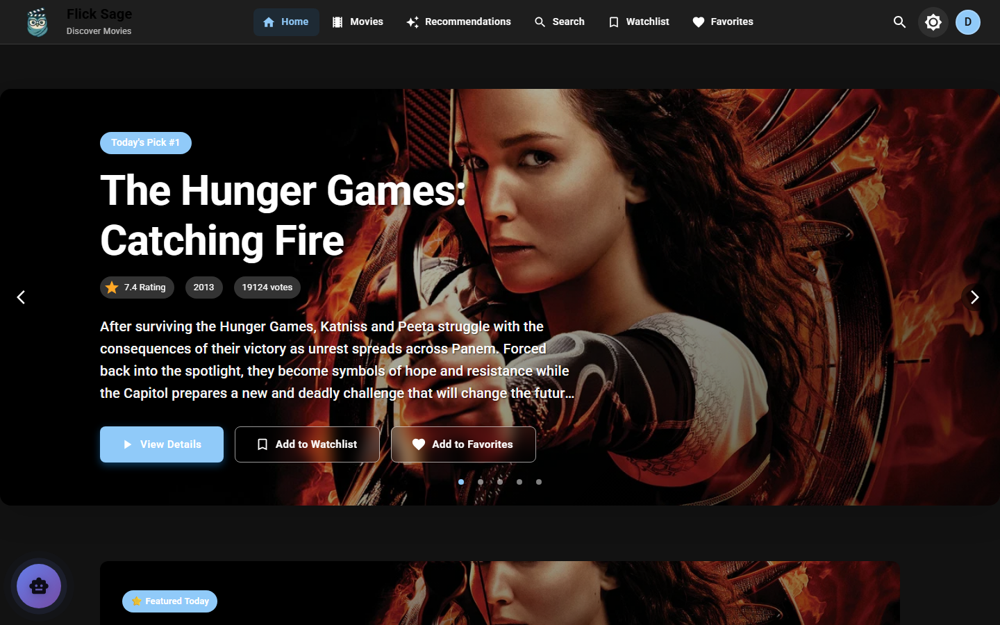 | | |

## ✨ Özellikler

| Özellik | Açıklama |
|---|---|
| 🔐 Kimlik doğrulama | E-posta ve şifreyle kayıt / giriş. Şifreler bcrypt ile hash'lenir; oturum, localStorage'da ve HTTP-only cookie'de tutulan 7 günlük JWT ile yönetilir. |
| 👨‍👩‍👧 Aile profilleri | Hesap başına en fazla 5 profil ("Who's watching?"), her birinin kendi favorileri ve izleme listesi vardır. Profiller oluşturulabilir, düzenlenebilir, silinebilir ve çocuk profili olarak işaretlenebilir (rozetle gösterilir). |
| 🏠 Ana sayfa | Hero carousel ("Today's Pick"), TMDB'den trend, popüler, en yüksek puanlı ve yakında çıkacak filmler, tür kısayolları ve on yıllara göre seçkiler. |
| 🤖 Yapay zekâ önerileri | Ana sayfadaki sohbet tarzı asistan, isteğinizi ve favori filmlerinizi Google Gemini'ye gönderir; dönen 3 öneri TMDB ile eşleştirilir. |
| 🎯 Kategoriye göre öneri | Bir tür seçin, rastgele bir öneri alın; "New Suggestion" ile izlemediğiniz başka bir film çekin. |
| 🔎 Arama | Sunucu tarafı API route'u üzerinden film arama, popüler arama kısayolları ve header'da hızlı arama. |
| 📈 Trend analizi | Bugün / bu hafta / bu ay / tüm zamanlar sekmeleri ve özet istatistikler (sayı, ortalama puan, popülerlik, öne çıkan türler). |
| 🗂️ Tüm türler | Filmleri türe göre gezme, sıralama ve "daha fazla yükle" sayfalama. |
| 🎞️ Film detayı | Arka plan, afiş, slogan, süre, türler, özet, oyuncu ve ekip, YouTube fragmanı ve paylaş butonu. |
| ❤️ Favoriler | Profil bazında favori ekleme / çıkarma. |
| 📌 İzleme listesi | "To Watch" ve "Watched" sekmeleri; filmleri izlendi olarak işaretleme. |
| 👤 Profil sayfası | İstatistikler (izlenen, favori, izleme listesi, ortalama puan), son aktiviteler, başarımlar, profil fotoğrafı, şifre ve e-posta değiştirme. |
| 💾 Veri dışa / içe aktarma | Profilin izleme listesini ve favorilerini JSON olarak dışa aktarma ve geri yükleme. |
| 🌗 Karanlık mod | Açık / koyu tema geçişi, localStorage'a kaydedilir. |
| 🛡️ İçerik filtresi | Yetişkin ve uygunsuz içerikler TMDB sonuçlarından ayıklanır. |

## 🧰 Teknolojiler

| Katman | Teknoloji |
|---|---|
| Framework | Next.js 15 (App Router, Route Handlers) |
| Arayüz | React 19, Material UI 7, Emotion, Tailwind CSS 4 |
| Dil | TypeScript 5 |
| Veritabanı | PostgreSQL |
| ORM / migration | Drizzle ORM, drizzle-kit |
| Kimlik doğrulama | jsonwebtoken, bcryptjs |
| Harici API'ler | TMDB (film verisi ve görseller), Google Gemini (yapay zekâ önerileri) |

## 🏗️ Mimari

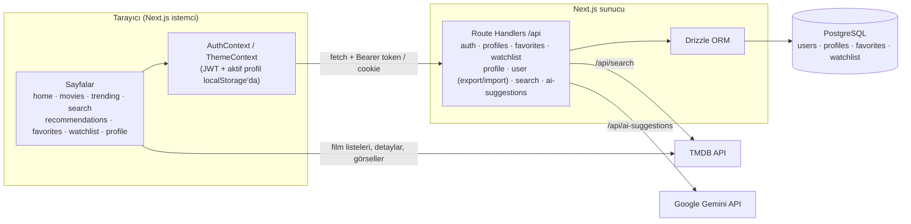

## 📁 Proje Yapısı

```
flicksage/
├── drizzle/                  # drizzle-kit meta verileri
├── public/                   # logo ve statik dosyalar
├── docs/                     # demo video, GIF ve ekran görüntüleri
├── src/
│   ├── app/
│   │   ├── api/
│   │   │   ├── auth/         # register, login, logout, change-password, update-email
│   │   │   ├── profiles/     # profil CRUD + seçim
│   │   │   ├── profile/      # hesap istatistikleri ve profil güncelleme
│   │   │   ├── favorites/
│   │   │   ├── watchlist/
│   │   │   ├── user/         # export-data, import-data, update-profile-picture
│   │   │   ├── search/
│   │   │   └── ai-suggestions/
│   │   ├── homepage/  movies/  trending/  all-genres/  recommendations/
│   │   ├── search/  movie/[id]/  favorites/  watchlist/
│   │   ├── profile/  profiles/  login/  register/
│   │   ├── layout.tsx
│   │   └── page.tsx          # karşılama sayfası
│   ├── components/Header.tsx
│   ├── contexts/             # AuthContext, ThemeContext
│   ├── lib/
│   │   ├── auth.ts           # hash, JWT, doğrulama
│   │   └── db/               # Drizzle istemcisi ve şema
│   └── utils/avatars.ts
├── drizzle.config.ts
└── package.json
```

## 🚀 Kurulum

### Gereksinimler

- Node.js 20+
- Bir PostgreSQL veritabanı
- [TMDB API anahtarı](https://www.themoviedb.org/settings/api)
- [Google Gemini API anahtarı](https://aistudio.google.com/app/apikey) (yalnızca yapay zekâ önerileri için)

### Adımlar

```bash
git clone https://github.com/LordAurora/flicksage.git
cd flicksage
npm install
```

Proje kök dizininde `.env.local` dosyası oluşturun:

```env
DATABASE_URL=
JWT_SECRET=
NEXT_PUBLIC_TMDB_API_KEY=
GEMINI_API_KEY=
```

| Değişken | Açıklama |
|---|---|
| `DATABASE_URL` | PostgreSQL bağlantı adresi |
| `JWT_SECRET` | Token imzalamak için uzun, rastgele bir değer (zorunlu; tanımlı değilse istekler reddedilir) |
| `NEXT_PUBLIC_TMDB_API_KEY` | TMDB v3 API anahtarı (tarayıcıda ve `/api/search` içinde kullanılır) |
| `GEMINI_API_KEY` | Google Gemini API anahtarı (yalnızca sunucu tarafı) |

Tabloları oluşturup uygulamayı başlatın:

```bash
npm run db:push
npm run dev
```

[http://localhost:3000](http://localhost:3000) adresini açın.

## 📜 Komutlar

| Komut | Açıklama |
|---|---|
| `npm run dev` | Geliştirme sunucusunu başlatır (Turbopack) |
| `npm run build` | Production build alır |
| `npm run start` | Production build'i çalıştırır |
| `npm run db:push` | Drizzle şemasını veritabanına uygular |
| `npm run db:generate` | Şemadan SQL migration'ları üretir |
| `npm run db:migrate` | Üretilen migration'ları uygular |
| `npm run db:studio` | Drizzle Studio'yu açar |

## 🙏 Teşekkürler

Bu ürün TMDB API'sini kullanır ancak TMDB tarafından onaylanmış veya sertifikalandırılmış değildir. Film verileri ve görseller hak sahiplerine aittir ve [The Movie Database](https://www.themoviedb.org/) tarafından sağlanır.

Ekran görüntüleri ve demo videosu, kurgusal bir demo hesabıyla lokal bir veritabanında kaydedilmiştir.
